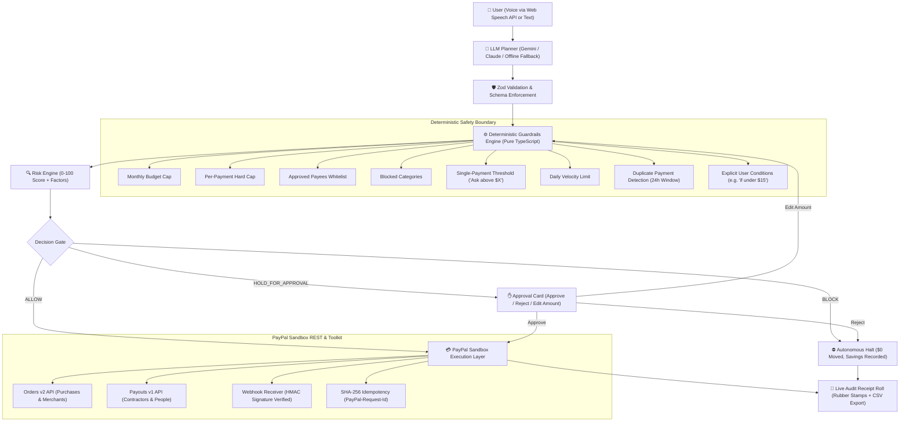

# PayPilot 🧭
> **"Let AI handle the payments. You keep the final say."**

[-success?style=flat-square)](file:///c:/Users/mr.ss/Desktop/PayPilot/src/lib/guardrails/engine.test.ts)
[](https://developer.paypal.com)
[-blueviolet?style=flat-square)](file:///c:/Users/mr.ss/Desktop/PayPilot/src/app/api/agent/tools/route.ts)
[](file:///c:/Users/mr.ss/Desktop/PayPilot/LICENSE)

PayPilot is an autonomous spending leash and private ledger for AI agents. When a user states a payment task in plain English (or voice), PayPilot plans it, checks it against deterministic rules, scores risk, requests human approval when needed, executes through PayPal Sandbox, and records every decision on a live, tamper-evident audit receipt roll.

Built for the **PayPal AI Agent Hackathon 2026**.

---

## The Problem We Solve
AI agents can now browse, compare, and decide—**but nobody trusts them with money**.
Giving an LLM direct API access to move funds risks catastrophic hallucinations, prompt injections, duplicate invoices, and runaway spending.

PayPilot solves this with a strict architectural boundary:
> **The LLM PROPOSES. Deterministic code DECIDES.**
The LLM never has direct authority to move money. Every payment passes through a rules engine written in plain TypeScript, verified by 27 unit tests, before any call touches PayPal.

---

## Architecture Diagram



---

## Key Features

1. **Task Input with Voice & Text**: Voice input via the browser Web Speech API, text input, and quick-load example scenarios.
2. **Structured JSON Planner**: Decomposes natural language into structured JSON steps (payee, amount, currency, purpose, category, conditions). Validated with Zod schemas with automatic retries and deterministic offline fallback.
3. **Deterministic Guardrails Engine**: Zero network dependencies, pure TypeScript rules engine:
   - Monthly budget cap
   - Hard per-payment cap
   - Approved payee whitelist with per-payee pre-authorized limits
   - Blocked merchant categories
   - "Ask me above $X" single payment threshold
   - Daily velocity limits (max payments per 24 hours)
   - 24-hour duplicate payment protection
   - Explicit inline user constraints (e.g., "if under $15" -> vendor asks $18 -> BLOCKED)
4. **Risk Scoring Engine**: Scores risk from 0 to 100 based on payee novelty (+35), historical amount outliers (+25), high-pressure/urgency cues (+15), and invoice spoofing patterns (+7), with plain-English human explanations.
5. **Approval Flow**: Accessible, screen-reader friendly approval cards showing what, to whom, how much, why it was held, and the specific rule involved. Supports 1-click Approve, Reject, or inline Amount Editing.
6. **PayPal Sandbox Integration**:
   - **Orders v2 API** (`/v2/checkout/orders` and `/capture`) for merchant purchases.
   - **Payouts v1 API** (`/v1/payments/payouts`) for paying people & contractors.
   - **Webhook Signature Verification** (`/v1/notifications/verify-webhook-signature`) for cryptographically verifying transmissions.
   - **Deterministic Idempotency**: Every payment generates a SHA-256 idempotency key passed to `PayPal-Request-Id`.
   - **PayPal Agent Toolkit / MCP**: Exposes compliant tool definitions (`paypal_propose_payment`, `paypal_evaluate_guardrails`, `paypal_get_balance_and_budget`).
7. **Signature Live Audit Tape**: Styled as a physical receipt roll with perforated edges, monospaced typography, and rubber stamps (`PAID`, `HELD`, `BLOCKED`, `VERIFIED`) with ink-settle physics animations. Exportable to RFC-4180 CSV.
8. **Dashboard & Spend Metrics**: Real-time spending leash meter, pending approvals counter, and a live counter of savings from blocked payments (*"PayPilot stopped $1,240 this month"*).
9. **Interactive Guardrails Simulator**: "What Would Be Blocked?" simulator allows testing hypothetical transactions against active policies before deploying money.
10. **Undo & Dispute Claim Assistant**: Packages settled transactions into formal PayPal Resolution Center claim drafts with cryptographic evidence items and deep links.
11. **90-Second Demo Runner**: One-click button that plays the full demo scenario with zero latency or network friction.

---

## The Demo Scenario (90 Seconds)

**Task:**
> *"Pay Riya $200 for the logo work, renew my domain if it's under $15, and send $900 to a new vendor called QuickInvoice Ltd."*

1. **Riya Sharma ($200)**: Pre-approved contractor within authorized spending bounds ($200 <= $250 limit) $\rightarrow$ **ALLOW**, paid via PayPal Payout batch.
2. **Domain Renewal ($18)**: Vendor renewal quote is $18, exceeding the user's explicit condition of $15 $\rightarrow$ **BLOCK**, $0 moved, reason documented.
3. **QuickInvoice Ltd ($900)**: New payee, 8.2x historical average outlier, urgent phrasing $\rightarrow$ **HOLD** with risk score 82/100.
4. **User Action**: The user inspects the card, clicks **Reject Payment**, and the dashboard updates: **"PayPilot stopped $1,240 this month"**.

---

## Quickstart (Under 5 Minutes)

### 1. Prerequisites
- Node.js 18+ (tested on Node v20/v26)
- npm or pnpm

### 2. Clone & Install
```bash
git clone https://github.com/your-username/PayPilot.git
cd PayPilot
npm install
```

### 3. Configure Environment (Optional)
The project works **out of the box with zero configuration** in Demo Mode with full offline fallbacks and authentic PayPal Sandbox mocks. To connect your live PayPal developer sandbox credentials:

Copy `.env.example` to `.env.local`:
```bash
cp .env.example .env.local
```
Fill in your credentials:
```env
PAYPAL_CLIENT_ID=your_sandbox_client_id
PAYPAL_CLIENT_SECRET=your_sandbox_client_secret
PAYPAL_ENVIRONMENT=sandbox
PAYPAL_WEBHOOK_ID=your_webhook_id
GEMINI_API_KEY=your_gemini_api_key
```

### 4. Run Unit Tests (27 Cases)
```bash
npm test
```
All 27 guardrail unit test cases will run and pass in under 5 seconds.

### 5. Launch Development Server
```bash
npm run dev
```
Open [http://localhost:3000](http://localhost:3000) in your browser.
Click **"Run 90s Demo"** in the top navigation to play the complete scenario!

---

## Security Model

1. **Deterministic Authority Separation**:
   LLMs generate structured payment intents; plain TypeScript functions make the authorization decision. No prompt injection or jailbreak can bypass TypeScript conditional statements.
2. **Idempotency by Design**:
   Payment requests compute `sha256(stepId:payee:amount:currency)` sent as `PayPal-Request-Id`. Retried network calls can never create double debits.
3. **Cryptographic Webhook Verification**:
   Inbound PayPal webhook events verify signature, cert URL, transmission ID, and algorithm against PayPal's verification API before updating state.
4. **Zero Client Secrets**:
   All PayPal client secrets and API keys remain strictly server-side in Next.js API route handlers. No sensitive keys are exposed to the client.

---

## Limitations & Production Roadmap

- **Multi-Currency FX**: Current version defaults to USD. Production roadmap includes real-time PayPal FX quotes for multi-currency cross-border agent disbursements.
- **Biometric WebAuthn Approval**: Currently uses session approval cards. Production roadmap will support passkey/TouchID biometric sign-off for payments over $500.
- **Smart Contract Escrow**: Integration with PayPal USD (PYUSD) for conditional milestone-based escrow smart contracts.
